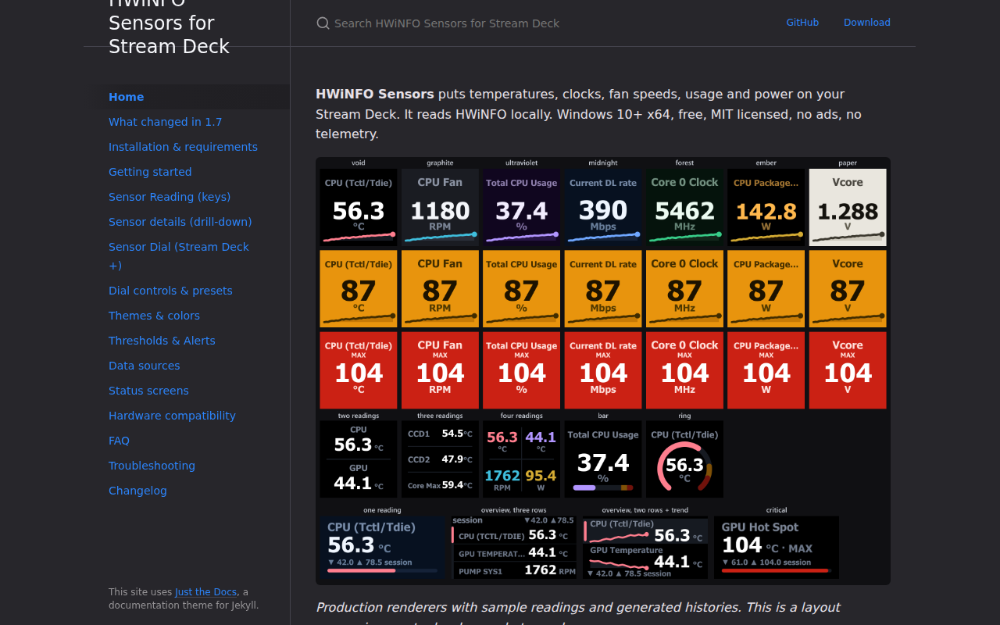
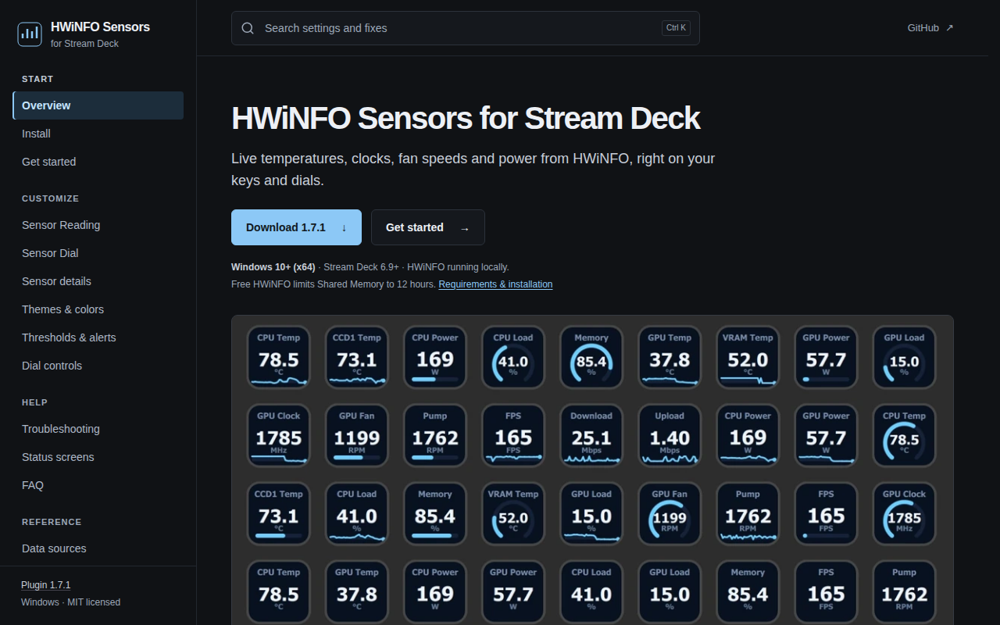
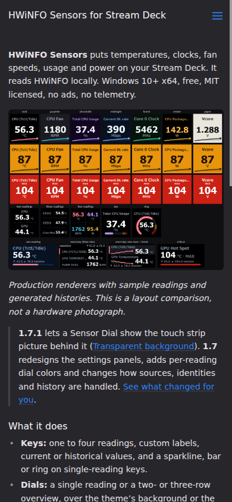
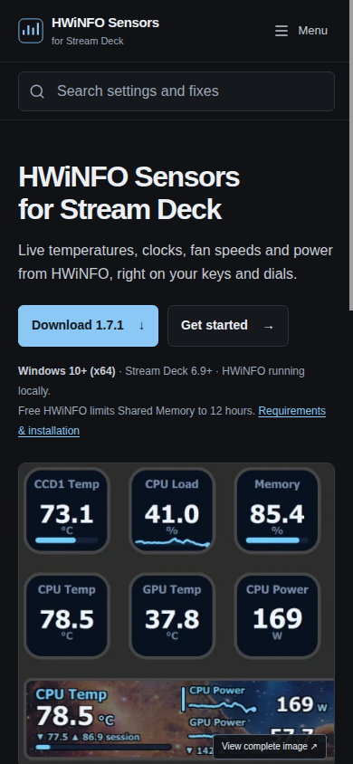

# Documentation redesign review

Audit date: 24 October 2026. Scope: the complete documentation site, its assets, and documentation build, test and preview tooling. Plugin runtime, native code, manifests, release history and production publication are unchanged.

## Source and release identity

The audited source is [bb4aedecbce499e199df8af63793a1490c0fb6ed](https://github.com/slawrensen/hwinfo-streamdeck/commit/bb4aedecbce499e199df8af63793a1490c0fb6ed). The separately resolved annotated [v1.7.1 tag](https://github.com/slawrensen/hwinfo-streamdeck/releases/tag/v1.7.1) points to that commit; the stable package is 1.7.1.0. Marketplace was checked separately and advertises 1.7, with 1.7.0.0 release notes. [Release evidence](release-evidence.md) records source-backed claims and their qualifications.

The existing preview repository is `slawrensen/hwinfo-streamdeck-preview`, with prior `main` head `ab75216427698c57df3ed7fb3a81e7c20f45675c`. Its last successful deployment at initial audit was [Pages run 40067243530](https://github.com/slawrensen/hwinfo-streamdeck-preview/actions/runs/40067243530). Open source PRs and both heads were inspected before editing and again before publication; no concurrent branch was rewritten. The source branch is `docs/dark-preview-20261024`.

The final source commit, generated preview commit, successful deployment run and served-byte verification are recorded in the review PR. The preview carries `docs-build.json` and per-page build/source metadata so publication can be tied to its exact source without making a circular source-commit claim in this file.

## Design and content decisions

Three compositions were compared using genuine repository assets: a healthy whole-deck app capture, a focused transparent-dial strip, and renderer comparison boards. The healthy Midnight deck with transparent Tint dials gives the clearest attainable overview. A faithful detail crop makes those same readings legible on phones; its link opens the complete original. Dense theme and alert comparisons belong in the theme reference. No synthetic product UI was generated.

The shared shell uses charcoal surfaces, one cool accent, restrained borders, system fonts, and reusable spacing/color tokens. The article measure stays at 76ch, including tablets; a centered 1560px shell makes ultrawide layouts deliberate. Start, Customize, Help and Reference organize the existing destinations. Help precedes the longer reference list so Troubleshooting is visible on ordinary laptops. Search remains visible when the mobile menu is closed. The page's group and current link remain clear.

The homepage leads with product identity, one sentence, the pinned stable download, Get started, and essential requirements before the main image. It has approximately 152 visible main-content words including captions, credits and the channel note, comfortably below the requested budget. Desktop and phone first-screen tests check the actual geometry rather than shrinking controls to fit.

Get started follows Install → enable sharing → add Sensor Reading → select a reading → confirm a value. All fourteen standalone guides received a content review and targeted edits; the homepage and generated changelog complete the sixteen original pages. A matching 404 page was added. Existing concise reference text remains where it is useful. Source requirements, the free Shared Memory timer, Gadget freshness and history, explicit identity links, local dial statistics, custom-color contrast limits, and dated physical versus simulated compatibility remain visible or directly linked. Installation no longer claims that every hardware model works.

The Sensor Dial guide leads with **Display → Background**, the exact mode names, and contrast limitations. Each encoder remains a 200×100 segment. A shared strip picture is never presented as a whole-strip graph. Signing status, separate install-channel verification, and attribution remain discoverable.

## Interaction and tooling repairs

The original modal defect was reproduced on live production and an independent baseline build: open the whole deck, focus Actual size, then Shift+Tab. Focus reached Edit this page behind the overlay. The new native dialog makes the background inert, contains Tab and Shift+Tab, supports actual-size scrolling, and restores focus after Escape or Close. Full-image links work without JavaScript.

The pinned Just the Docs v0.10.1 stack is retained. Its search script has a small attributed patch for input/paste/clear, queries entered before indexing finishes, and preserving page scroll during search. Disclosures open when a direct URL, search result, history navigation or in-page link targets their contents. Wide tables and code examples receive named keyboard-scroll regions. Images have intrinsic dimensions and deferred loading below the main image.

The publisher now stages immutable committed Git objects, applies a structural YAML overlay, preserves the redesigned shell, excludes private release paths, and rejects a repository CNAME. Authentication, permission and network errors cannot trigger repository creation or visibility changes. Publication retains the previous preview commit as parent and requires an explicit expected-head lease. A real concurrent-writer test exercises lease rejection. [Independent publisher review](publisher-review.md) records this review.

The crawler checks every original route, 192 preserved article fragments, internal links, all responsive image candidates, base paths, search content/targets, and nine private-path 404 probes. Preview mode additionally checks noindex, the visible marker, source SHA and build ID. The screenshot tool discovers Chrome across supported desktop platforms, owns and cleans up its browser process, captures complete long pages, and waits for lazy images to paint. A real-browser fixture verifies pixels below 19,000px and failure reporting for broken images.

The changelog wrapper was changed through `scripts/gen-changelog-page.mjs`; `npm run changelog:page` regenerates `docs/changelog.md` from the unchanged `CHANGELOG.md`. The shared layout provides its single H1. No manually divergent changelog copy was introduced.

## Actual review team and ownership

The environment permits four concurrent agents including the coordinator. Work used that limit with a further independent-review wave:

| Agent | Deliverables and ownership | Independent review |
| --- | --- | --- |
| Coordinator | Shared visual system, shell, homepage, search patch, integration, GitHub publication and deployment verification | Reviewed agent-owned content, tooling and evidence |
| `release_accuracy` | Release/source/channel audit; immutable preview publisher and tests; browser regressions and combined-state Escape repair | Reviewed other authors' content and shell; all-route axe and interaction checks |
| `assets_provenance` | Candidate image inspection, faithful derivatives, provenance; cross-platform screenshot tooling and tests | Full-page visual review at desktop/phone and selected additional widths |
| `content_structure` | Fourteen guide edits, missing-page content, route continuity; crawler and tests | Reviewed the publisher authored by `release_accuracy` |
| `independent_final` | Fresh final review after implementation | Code/rendered responsive review, no-JS, reduced motion, zoom/reflow, loading measurements, and repair retests |

No agent edited the shared shell concurrently with the coordinator. Later reviewers inspected code and rendered pages they did not author. [Interaction review](interaction-review.md) and [visual review](visual-review.md) record severities, reproductions, user impact and retests. [Asset review](asset-review.md) and [screenshot tooling review](screenshot-tooling-review.md) record image and capture decisions. [Final performance and layout review](final-review.md) records conditions, measurements, actual 200% browser zoom, and repair retests. Machine-readable evidence is in `checks/`.

## Validation and limits

The documentation is built with real Jekyll 3.10 and the pinned theme, separately from the plugin build. Both `/hwinfo-streamdeck/` and the committed preview's `/hwinfo-streamdeck-preview/` are validated before publication. The review PR contains the final PASS/FAIL/UNAVAILABLE result table and deployment-specific evidence.

Accepted browser evidence uses standard certificate verification. Automated screenshots are labelled as local Jekyll builds of the audited baseline or candidate, not falsely labelled live-production captures. Live production was also visually inspected through the browser, including the exact focus defect. The published preview is checked separately after its matching Pages run succeeds.

Windows/HWiNFO installation, physical-device testing, native/plugin release qualification, private release-only runbooks/copy inputs, and fresh manual VirusTotal validation are unavailable in this documentation environment and are not reported as passed. Historical hardware evidence stays labelled with its date and scope. Automated accessibility checks supplement manual review; they do not certify complete compliance or supply field Core Web Vitals.

Production promotion is outside this task. The intentional absence of a repository CNAME, inherited custom domain, existing HTML routes, important fragments, search, and exclusion of `docs/release/` are preserved.

## Before and after

These are browser screenshots of the local audited baseline and reviewed candidate. They preserve the actual app captures and do not fabricate product output.

| Viewport | Before | After |
| --- | --- | --- |
| 1280×800 |  |  |
| 390×844 |  |  |
