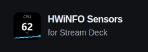
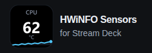

# Larger branding and predictable image viewing

## Scope and reviewed baseline

This documentation follow-up implements the owner's approved 72 px desktop and 56 px smaller-screen logo, fixes the supplied Fit/Actual image-viewer reproduction, and corrects two nearby navigation spacing defects found during independent review.

The isolated branch starts at production commit `63861eb3d34fd5c6ee24b70168f2dca553c64014`. The inspected preview head was `4c65158f4275371a4ed8dcc8ace7ddda1be78ebc`, generated from reviewed source `8531e84bc59554b1bf5809b6f06ae2776e35e644`. Other open source PRs were inspected and left in their existing branches. Publication identities and the final expected-head lease are recorded in this change's PR after deployment verification.

## Decisions and reproduced defects

| Area | Result |
| --- | --- |
| Actual project logo | 72 × 72 CSS pixels from a 1200 px viewport; 56 × 56 below it. Responsive sources provide 1× and 2× image density. The released CPU 62 °C tile is unchanged. |
| Brand spacing | A 76 px smaller-screen header gives the 56 px icon breathing room. Desktop and narrow-laptop header gutters allow the unchanged 16/14 px wordmark to fit on its intended two lines. |
| Narrow Menu control | Up to 360 px, the visible Menu label remains and its redundant decorative icon is omitted. This resolves the reproduced 320 px reflow collision while preserving a 44 px target. |
| Phone navigation | The inherited 40 px line-height made a two-line label occupy 92 px. Explicit 1.4 line-height keeps related words together, with 16 px text and 44 px minimum targets. Narrow-menu gutters and padding also keep Troubleshooting inside its own clickable target. |
| Fit to screen | The complete image fills the available viewing area while retaining its aspect ratio. Smaller sources can enlarge, so Fit is useful on ultrawide screens. |
| Actual size | Original image dimensions are preserved. An image stays centered on each axis where it fits; oversized axes scroll to every edge. |
| Viewer button semantics | The changing label describes the next action. Removing the contradictory pressed state avoids announcing Fit as selected while Actual is displayed. |
| Deployment cache | The authored CSS and viewer script carry the HTML build identifier in their URLs. A reproduced live reload had new HTML with cached old styling; versioned asset URLs keep an existing browser session on the same build. |

The independent visual review found no reason for another global font increase or a wider workspace. Body text, controls, supporting text and article measure retain the previously reviewed scale. The viewer repair uses CSS sizing, with no new dependency or sizing JavaScript.

## Before and after

These are authentic browser captures of local Jekyll builds, not synthetic product UI or a live deployment attestation. The before header is from the preserved `8531e84` preview build. Candidate captures are bound to the source hashes in the [independent browser report](logo-scale-tests.md).

| Before, 48 px | Approved desktop, 72 px |
| --- | --- |
|  |  |

[56 px phone header](logo-scale/header-after-phone.png) · [Corrected phone menu](logo-scale/menu-after-phone.png)

The user's reported image is `dial-backgrounds-looks.jpg`, with original dimensions of 1264 × 352. At a 2048 × 1220 viewport, corrected Fit paints approximately 1958 × 545 px. Actual displays 1264 × 352 at the same center point. At 3440 × 1440, Fit paints approximately 3350 × 933 px; Actual remains native and centered.

[Fit to screen, desktop](logo-scale/viewer-fit-desktop.png) · [Actual size, desktop](logo-scale/viewer-actual-desktop.png)

On a 390 × 844 phone, Fit preserves the complete strip at approximately 356 × 99 px. Actual remains 1264 × 352, centered vertically, with horizontal panning. The 1300 × 710 whole-deck capture also fits completely and can pan on both axes at Actual size. These are viewing changes, not edits to the images.

## Validation and actual reviewers

Four specialist agents worked in successive waves, with at most three helpers active alongside the coordinator:

- `logo_scale_review`: released-image provenance and four optimized logo derivatives.
- `logo_regressions`: independent regression tests and execution; did not implement the shared shell or viewer.
- `logo_usability_review`: independent source and rendered-capture review, including the user-supplied viewer screenshots and retests.
- `production_regressions`: independent logo integration review, then the bounded image-viewer correction and reproduction evidence.
- Coordinator: shared branding/navigation implementation, integration, source review, publication and deployment verification.

| Result | Check |
| --- | --- |
| PASS | Real Jekyll builds at the production and preview base paths, using the pinned Just the Docs theme. |
| PASS | 51 browser cases per base path, 102 executions, no failures or skips. See the [independent browser report](logo-scale-tests.md). |
| PASS | The new primary viewer test fails on the unchanged baseline specifically at the painted-image Fit-scale assertion, then passes on the corrected build. |
| PASS | Logo, wordmark, Menu and document bounds at 320, 360, 390, 768, 1000, 1199, 1200, 1280 and 3440 CSS pixels, including classic-scrollbar reflow. |
| PASS | Actual-size edge panning, Fit/Actual centering, resize, different images, cached reopening, keyboard focus containment, background blocking and focus restoration. |
| PASS | Search, disclosures, deep links, current/legacy navigation, responsive images and JavaScript-disabled native home links remain covered. |
| PASS | 45 documentation tooling tests and lint. One optional synthetic screenshot-fixture case was not enabled; the real screenshot workflow ran separately. |
| PASS | All 11 brand-manifest assets match their recorded hashes, bytes and dimensions. New derivatives match direct Lanczos resampling of the released master. |
| UNAVAILABLE | Physical Windows/HWiNFO/Stream Deck testing and private plugin-release qualification. These are documentation-only changes. |
| UNAVAILABLE | New field performance measurements and a complete accessibility certification; neither is claimed. |

The isolated headless browser could not validate the live HTTPS preview because its certificate trust rejected that origin. No certificate exception was added. Final live verification uses the connected browser and strict HTTPS content/deployment checks, recorded separately in the PR. Local browser results above remain scoped to the local Jekyll builds.

The first publication of this follow-up exposed the cache mismatch in the connected browser. It was not accepted as complete. The final PR record identifies the subsequent deployment with versioned authored assets and the live retest.
